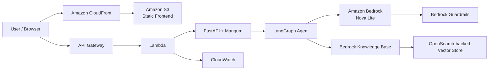
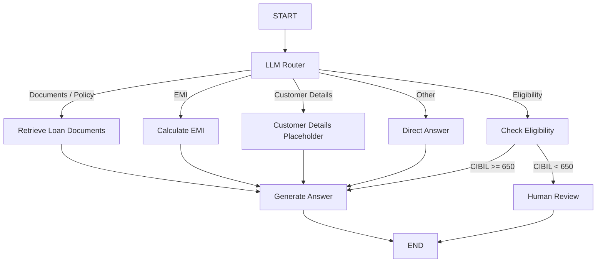

# LoanAssist AI

**LoanAssist AI** is an AWS serverless, agentic RAG assistant for loan-process and policy support. It combines **FastAPI, LangGraph, Amazon Bedrock, Bedrock Knowledge Bases, OpenSearch-backed retrieval, Lambda, API Gateway, S3, CloudFront, IAM, Bedrock Guardrails, and CloudWatch**.

The assistant can route a customer query to document retrieval, EMI calculation, preliminary eligibility checking, customer-details lookup placeholder, or a direct answer. A CIBIL score below **650** is routed to a human-review response. The application **never automatically approves or rejects a loan**.

> **Disclaimer:** LoanAssist AI is an informational assistant only. It does not provide legal or financial advice and must not be used as an automated loan approval/rejection system.

---

## 1. Architecture



### Main request path

```text
Browser
  ↓
CloudFront
  ↓
S3 static frontend
  ↓
API Gateway
  ↓
AWS Lambda
  ↓
FastAPI + Mangum
  ↓
LangGraph agent/router
  ├── Knowledge Base retrieval
  ├── EMI calculation
  ├── Preliminary eligibility
  ├── Customer details placeholder
  └── Direct answer
  ↓
Amazon Bedrock Nova Lite
  ↓
Response
```

---

## 2. AWS Components Used

| Component | Purpose |
|---|---|
| Amazon S3 | Stores the static HTML/CSS/JavaScript frontend |
| Amazon CloudFront | CDN and HTTPS delivery for the frontend |
| API Gateway | Public HTTP entry point for backend APIs |
| AWS Lambda | Serverless backend execution |
| FastAPI | Python API framework |
| Mangum | Adapts FastAPI/ASGI to Lambda |
| LangGraph | Agent orchestration and conditional routing |
| Amazon Bedrock Nova Lite | LLM used for routing and answer generation |
| Bedrock Knowledge Bases | Retrieves relevant loan-policy/document content |
| OpenSearch-backed vector store | Stores/searches Knowledge Base embeddings |
| Bedrock Guardrails | Adds configurable model safety controls |
| IAM | Controls Lambda access to Bedrock and other AWS resources |
| CloudWatch | Lambda logs, monitoring and troubleshooting |
| AWS SAM / CloudFormation | Infrastructure deployment |

---

# 3. Agent / LangGraph Workflow

The application is not only a simple RAG chain. LangGraph coordinates an agent-style workflow.



### Current agent capabilities

- LLM-based action/router
- Knowledge Base document retrieval
- EMI calculation
- Preliminary eligibility check
- Customer details tool placeholder
- Conditional LangGraph routing
- Session-based in-memory conversation history
- Human-review response when CIBIL is below 650
- No automatic loan approval/rejection

### Important

The customer-details capability is intentionally a placeholder. A production implementation should connect it to an authenticated CRM/core-banking API and should not expose raw customer PII to the LLM.

---

# 4. End-to-End Deployment

This section describes the deployment performed for LoanAssist AI from AWS resource preparation to the final CloudFront-hosted application.

## Step 1 — Prerequisites

Install/configure:

- Python 3.11
- AWS CLI
- AWS SAM CLI
- An AWS account
- AWS credentials with the required IAM permissions
- An existing Bedrock Knowledge Base
- An existing Bedrock Guardrail if guardrails are enabled

Verify:

```powershell
python --version
aws --version
sam --version
```

Configure AWS credentials:

```powershell
aws configure
```

Confirm the active identity:

```powershell
aws sts get-caller-identity
```

Recommended deployment region:

```text
us-east-1
```

---

## Step 2 — Prepare Amazon Bedrock

The application uses:
you can use yours
```text
Amazon Nova Lite
Model ID:
amazon.nova-lite-v1:0
```

Nova Lite is invoked through the Bedrock Runtime `Converse` API.

Official documentation:

https://docs.aws.amazon.com/bedrock/latest/userguide/model-card-amazon-nova-lite.html

The application also uses:

- Bedrock Agent Runtime `Retrieve`
- Bedrock Runtime `Converse`
- Bedrock Guardrails through `ApplyGuardrail`/Converse guardrail configuration

The Lambda execution role must have the required Bedrock permissions.

At minimum, the deployed role needs permissions corresponding to:

```text
bedrock:Converse
bedrock:InvokeModel
bedrock:Retrieve
bedrock:ApplyGuardrail
```

For production, scope these permissions to the exact model, Knowledge Base and Guardrail ARNs instead of using wildcard resources.

---

## Step 3 — Prepare Environment Values

Create a local `.env` file from your example configuration.

Example:

```env
AWS_REGION=us-east-1
BEDROCK_MODEL_ID=amazon.nova-lite-v1:0
BEDROCK_KNOWLEDGE_BASE_ID=YOUR_KNOWLEDGE_BASE_ID
BEDROCK_GUARDRAIL_ID=YOUR_GUARDRAIL_ID
BEDROCK_GUARDRAIL_VERSION=DRAFT
ALLOWED_ORIGINS=http://localhost:5500
LOG_LEVEL=INFO
```

---

# 5. Deploy the Backend with AWS SAM

From the project root:

```powershell
sam build
```

A successful build produces:

```text
Build Succeeded
```

Then run the guided deployment:

```powershell
sam deploy --guided
```

During the guided deployment, provide:

- Stack name: for example `loanassist-ai`
- AWS Region: `us-east-1`
- Knowledge Base ID
- Guardrail ID if enabled
- Allowed origin

For the production frontend, the final allowed origin should be the CloudFront domain, for example:

```text
https://YOUR_CLOUDFRONT_DOMAIN
```

After deployment, SAM/CloudFormation creates the backend resources including:

```text
API Gateway
Lambda
IAM role
CloudFormation stack
```

The SAM template also exposes an API URL output.

---

# 6. Verify the Backend

Before configuring the frontend, test the health endpoint:

```text
GET https://YOUR_API_ID.execute-api.us-east-1.amazonaws.com/prod/health
```

Expected:

```json
{
  "status": "ok"
}
```

If `/health` works but `/api/v1/chat` fails, inspect the Lambda CloudWatch logs.

---

# 7. Chat API

## GET `/health`

Purpose:

- Verify API Gateway → Lambda → FastAPI connectivity.

Example response:

```json
{
  "status": "ok"
}
```

## POST `/api/v1/chat`

Endpoint:

```text
/prod/api/v1/chat
```

Example request:

```json
{
  "message": "What documents are required for a home loan?",
  "session_id": "demo-session-001"
}
```

Example response:

```json
{
  "answer": "The required documents depend on the loan product and applicant profile.",
  "session_id": "demo-session-001",
  "sources": [],
  "tool_used": "retrieve_loan_documents",
  "requires_human_review": false
}
```

For an eligibility request with a CIBIL score below 650:

```json
{
  "answer": "Your CIBIL score needs manual review by a loan officer. No automatic approval or rejection has been made.",
  "session_id": "demo-session-001",
  "sources": [],
  "tool_used": "check_loan_eligibility",
  "requires_human_review": true
}
```

---

# 8. Deploy the Frontend to S3

The frontend is a static application:

```text
frontend/
├── index.html
├── css/
│   └── styles.css
└── js/
    ├── app.js
    └── config.js
```

Create an S3 bucket for the frontend.

Upload the contents of the `frontend` directory to the bucket.

Example AWS CLI pattern:

```powershell
aws s3 sync frontend/ s3://YOUR_FRONTEND_BUCKET/
```

The frontend calls the API Gateway URL configured in:

```text
frontend/js/config.js
```

Example:

```javascript
window.LOANASSIST_API_URL =
  "https://YOUR_API_ID.execute-api.us-east-1.amazonaws.com/prod/api/v1/chat";
```

The API Gateway URL is not a secret. Do not put AWS credentials or other secrets in frontend JavaScript.

---

# 9. Configure CloudFront

Create or reuse a CloudFront distribution for the frontend S3 bucket.

Recommended configuration:

- Origin: S3 bucket
- Origin Access Control (OAC): enabled
- Viewer protocol: Redirect HTTP to HTTPS
- Default root object:

```text
index.html
```

The S3 bucket should not need to be publicly readable when CloudFront OAC is used.

After deployment, the frontend is available through:

```text
https://YOUR_CLOUDFRONT_DOMAIN
```

---

# 10. Configure CORS

CORS must allow the actual browser origin.

For the deployed frontend:

```text
https://YOUR_CLOUDFRONT_DOMAIN
```

Do not use:

```text
http://127.0.0.1:5500
```

as the only production origin.

For local development you can allow both:

```text
http://127.0.0.1:5500
https://YOUR_CLOUDFRONT_DOMAIN
```

After changing API Gateway/SAM CORS configuration, redeploy:

```powershell
sam deploy
```

Then refresh the CloudFront application.

If CloudFront cached an old frontend configuration, create an invalidation:

```text
/*
```

---

# 11. Final Production Request Flow

Once everything is deployed:

```text
1. User opens CloudFront URL
          ↓
2. CloudFront serves frontend from S3
          ↓
3. User submits loan question
          ↓
4. Browser sends POST /api/v1/chat
          ↓
5. API Gateway receives request
          ↓
6. Lambda invokes FastAPI
          ↓
7. LangGraph LLM router selects an action
          ↓
8. Selected tool runs
          ↓
9. Knowledge Base retrieval / calculation / eligibility
          ↓
10. Amazon Bedrock Nova Lite generates response
          ↓
11. Guardrail is applied when configured
          ↓
12. Lambda returns JSON
          ↓
13. Frontend displays answer and sources
```

---

# 12. Project Structure

```text
loanassist-ai/
│
├── frontend/
│   ├── index.html
│   ├── css/
│   │   └── styles.css
│   └── js/
│       ├── app.js
│       └── config.js
│
├── src/
│   ├── __init__.py
│   ├── lambda_handler.py
│   └── app/
│       ├── __init__.py
│       ├── agent.py
│       ├── config.py
│       ├── logging_config.py
│       ├── main.py
│       ├── schemas.py
│       └── services/
│           ├── __init__.py
│           └── bedrock.py
│
├── requirements.txt
├── template.yaml
├── README.md
└── .gitignore
```

### Important files

| File | Purpose |
|---|---|
| `src/app/agent.py` | LangGraph state, tools and conditional routing |
| `src/app/services/bedrock.py` | Bedrock Runtime and Knowledge Base calls |
| `src/app/main.py` | FastAPI application and API routes |
| `src/app/config.py` | Environment/runtime configuration |
| `src/app/schemas.py` | Request/response models |
| `src/lambda_handler.py` | Lambda entry point through Mangum |
| `template.yaml` | SAM/CloudFormation infrastructure |
| `frontend/js/app.js` | Chat UI and API calls |
| `frontend/js/config.js` | Frontend API endpoint |
| `.gitignore` | Prevents secrets/build/local files from being committed |

---

# 13. Monitoring and Troubleshooting

## CloudWatch

Lambda logs are available in:

```text
CloudWatch
→ Logs
→ Log groups
→ /aws/lambda/YOUR_LAMBDA_FUNCTION
```

Useful things to monitor:

- Lambda errors
- Lambda duration
- Lambda throttles
- API Gateway 4XX
- API Gateway 5XX
- Bedrock AccessDenied errors
- Bedrock throttling
- Knowledge Base retrieval failures

---

## Common Issue: CORS / Failed to Fetch

Browser error:

```text
Access to fetch ... has been blocked by CORS policy
```

Check:

1. CloudFront origin
2. API Gateway CORS
3. Lambda/FastAPI CORS
4. `ALLOWED_ORIGINS`
5. Redeploy after changing CORS
6. CloudFront cache/invalidation

The `Access-Control-Allow-Origin` value must match the browser origin.

---

## Common Issue: Bedrock AccessDenied

Example:

```text
not authorized to perform:
bedrock:InvokeModel
```

Check the Lambda execution role.

The role must allow the required Bedrock actions:

```text
bedrock:Converse
bedrock:InvokeModel
bedrock:Retrieve
bedrock:ApplyGuardrail
```

Also verify the model is available/enabled in the selected AWS Region.

---

## Common Issue: API Gateway / Lambda 502

Check:

```text
API Gateway
    ↓
Lambda integration
    ↓
Lambda CloudWatch logs
```

Typical causes:

- Lambda import error
- Missing dependency
- Incorrect Lambda handler
- Exception during startup
- Timeout
- Invalid response returned by Lambda

The configured handler is:

```text
src.lambda_handler.handler
```

---

## Common Issue: CloudFront Shows Old Frontend

After updating frontend JavaScript:

```text
Upload updated files to S3
        ↓
Create CloudFront invalidation
        ↓
Path:
/*
```

Then hard-refresh the browser.

---

# 14. Security

Current implementation includes:

- IAM-based AWS service authorization
- Lambda execution role
- CORS restrictions
- HTTPS through CloudFront
- Bedrock Guardrails
- S3 + CloudFront architecture
- Structured application logging

### Important production TODOs

#### 1. Add Cognito authentication

The current API does **not** use Cognito/JWT authentication.

Production flow should be:

```text
User
 ↓
Cognito
 ↓
JWT
 ↓
API Gateway Authorizer
 ↓
Lambda
```

#### 2. Replace in-memory session memory

Current memory:

```python
conversation_memory: dict[str, list[str]]
```

This is only suitable for a demo/prototype because Lambda execution environments are not a durable shared session store.

Recommended production options:

```text
DynamoDB
or
Redis / ElastiCache
```

#### 3. Replace wildcard IAM resources

The current SAM template uses wildcard resources for Bedrock permissions to simplify deployment.

For production, restrict permissions to exact:

- Foundation model ARN
- Knowledge Base ARN
- Guardrail ARN

#### 4. Secure customer details

Replace the placeholder customer-details tool with an authenticated CRM/core-banking API.

Do not expose raw customer PII to the LLM.

#### 5. Add CloudWatch alarms

Recommended alarms:

- Lambda Errors
- Lambda Throttles
- Lambda Duration
- API Gateway 5XX
- API Gateway 4XX
- Bedrock throttling/error indicators

#### 6. Optional custom domain

For production, use a custom domain such as:

```text
https://loanassist.example.com
```

with appropriate TLS/DNS configuration.

---

# 15. Testing

## Test 1 — Health

```http
GET /health
```

Expected:

```json
{
  "status": "ok"
}
```

## Test 2 — Document retrieval

Question:

```text
What documents are required for a home loan?
```

Expected:

```text
tool_used = retrieve_loan_documents
```

The response should use relevant Knowledge Base context.

## Test 3 — EMI calculation

Example:

```text
Calculate EMI for a 5000000 loan at 8.5% for 20 years
```

Expected:

```text
tool_used = calculate_emi
```

## Test 4 — Eligibility

Example:

```text
My CIBIL score is 720. Can I be preliminarily eligible?
```

Expected:

```text
tool_used = check_loan_eligibility
requires_human_review = false
```

The result is only preliminary and must not be treated as approval.

## Test 5 — Human review

Example:

```text
My CIBIL score is 620. Am I eligible?
```

Expected:

```text
tool_used = check_loan_eligibility
requires_human_review = true
```

The application must return a human-review response and must not automatically approve or reject the loan.

---

# 16. Cost Overview — us-east-1

Actual cost depends heavily on request volume, model tokens, Knowledge Base usage, vector-store capacity, storage, data transfer and logging. Do not treat the table below as a fixed monthly bill.

| AWS Component | Main billing dimension | Cost behavior |
|---|---|---|
| Lambda | Requests + execution duration / GB-seconds | Variable with API traffic and execution time |
| API Gateway | API requests + data transfer | Variable with request volume |
| S3 | Storage + requests + data transfer/features | Usually low for a small static frontend, but varies with usage |
| CloudFront | Data transfer + requests under pay-as-you-go, or selected flat-rate plan | Depends on delivery traffic and pricing plan |
| Bedrock Nova Lite | Input/output token usage | One of the main variable costs for chat usage |
| Bedrock Knowledge Bases | Retrieval/ingestion-related usage depending on configuration | Variable |
| OpenSearch Serverless | OCU compute + storage | Can become a significant cost depending on collection/capacity and activity |
| Bedrock Guardrails | Guardrail usage | Variable based on requests/features used |
| CloudWatch | Logs ingestion/storage/querying and monitoring features | Variable with log volume and retention |

### Cost-control recommendations

- Keep prompts and conversation history concise.
- Limit generated output tokens.
- Retrieve only the number of chunks needed.
- Use appropriate Knowledge Base chunking and retrieval settings.
- Monitor OpenSearch Serverless OCU usage.
- Configure maximum OpenSearch capacity where appropriate.
- Set CloudWatch log retention instead of keeping logs indefinitely.
- Avoid excessive CloudWatch Logs Insights queries.
- Use CloudFront caching for static frontend assets.
- Use AWS Budgets and billing alerts.
- Review Bedrock model usage regularly.
- Use the AWS Pricing Calculator before production launch.


AWS pricing can change; use the official pricing pages above for the current us-east-1 rates.

---

# 17. Current Limitations

This project is a production-style demonstration, but the following items should be completed before handling real customer/loan decisions:

- Cognito authentication and API Gateway JWT authorization
- Persistent conversation memory using DynamoDB or Redis
- Secure CRM/core-banking integration for customer details
- CloudWatch alarms and operational dashboards
- Production-grade audit logging
- Optional AWS WAF
- Custom domain and managed TLS


---

# 18. GitHub Safety

Never commit:

```text
.env
AWS credentials
.aws-sam/
venv/
samconfig.toml
private keys
tokens
passwords
```

The repository `.gitignore` is configured to exclude local environment files, Python virtual environments, SAM build artifacts and local SAM configuration.

Use placeholders in documentation:

```text
YOUR_KNOWLEDGE_BASE_ID
YOUR_GUARDRAIL_ID
YOUR_API_ID
YOUR_CLOUDFRONT_DOMAIN
```

---

# 19. Useful Commands

### Build

```powershell
sam build
```

### Validate

```powershell
sam validate
```

### Deploy

```powershell
sam deploy --guided
```

After the first guided deployment:

```powershell
sam deploy
```

### Check Git status

```powershell
git status
```

### Push changes

```powershell
git add .
git commit -m "docs: update deployment documentation"
git push
```

---

# 20. Project Status

**Status: Deployed / Working Demo**

Current deployed architecture:

```text
CloudFront
   ↓
S3
   ↓
API Gateway
   ↓
Lambda
   ↓
FastAPI
   ↓
LangGraph
   ↓
Bedrock Knowledge Base + OpenSearch-backed retrieval
   ↓
Amazon Nova Lite
   ↓
Response
```

The project demonstrates an end-to-end AWS serverless **Agentic RAG** application with document retrieval, tool routing, EMI calculation, preliminary eligibility checking, human-review routing, guardrails, monitoring and a CloudFront-hosted frontend.
