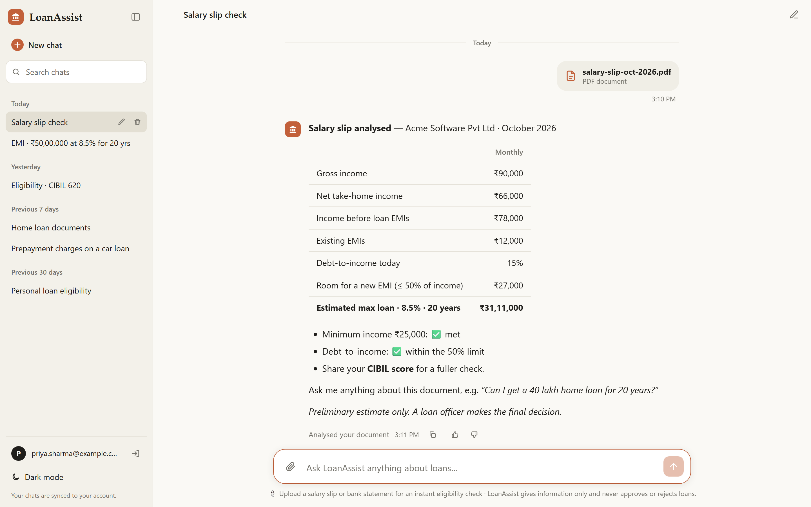
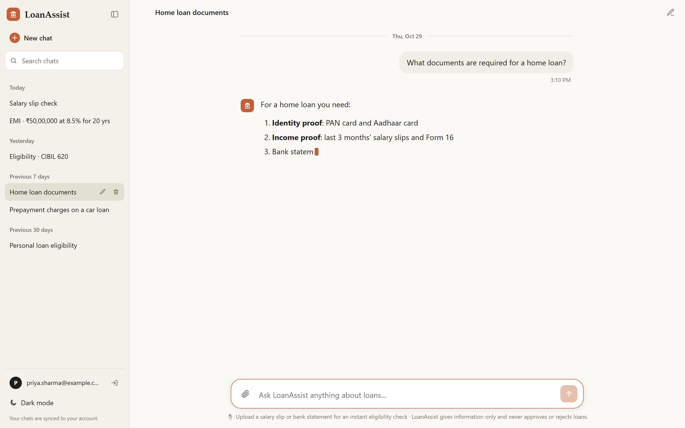
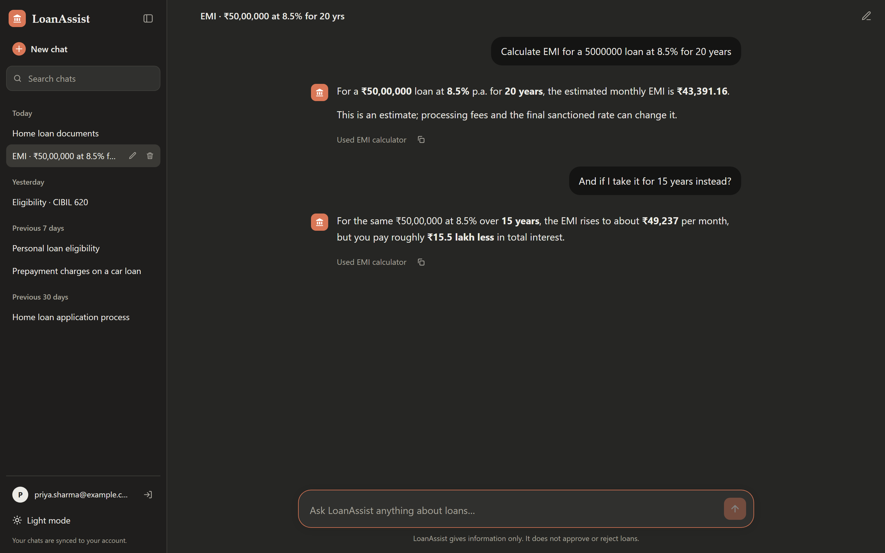
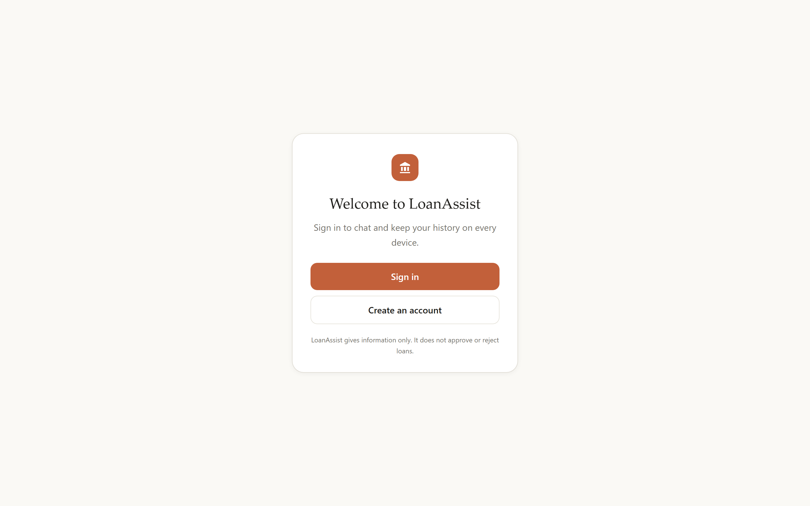
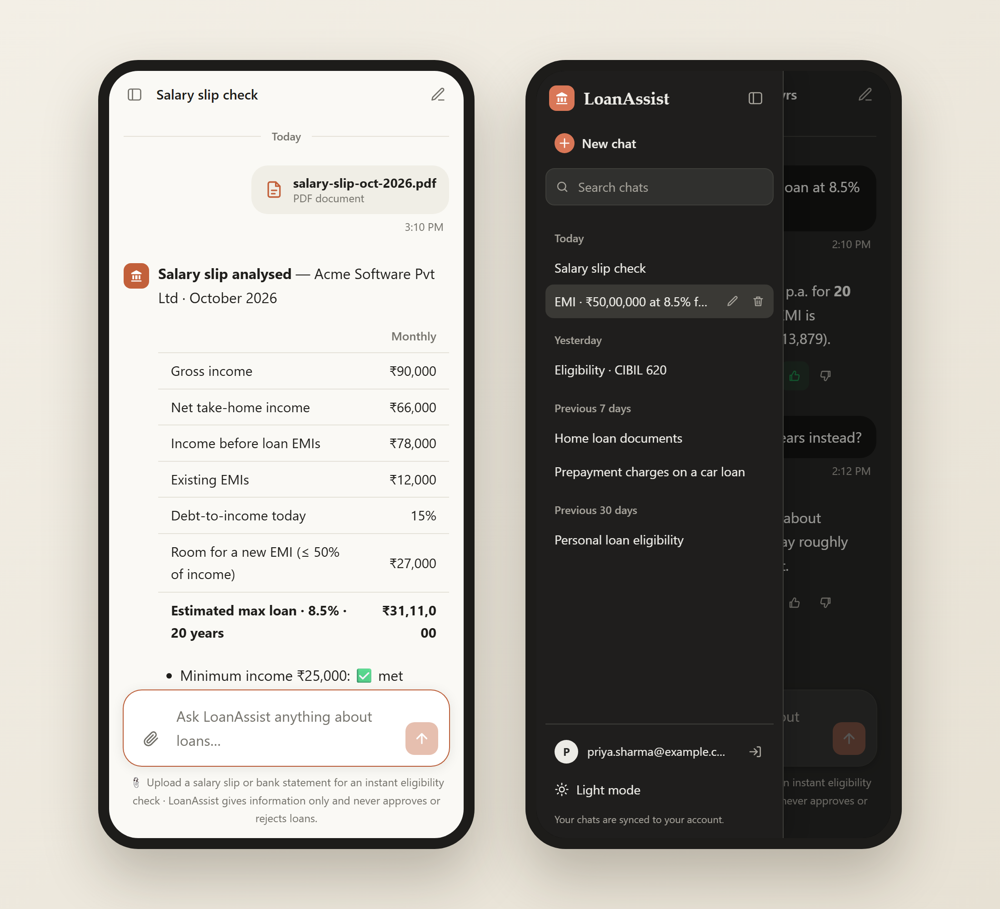
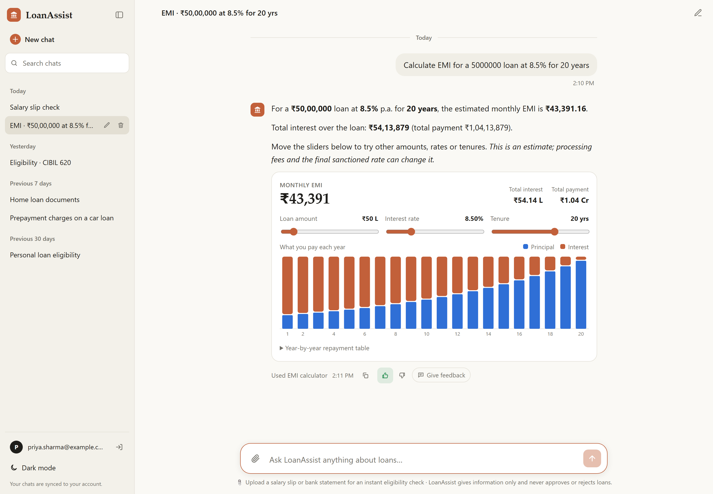
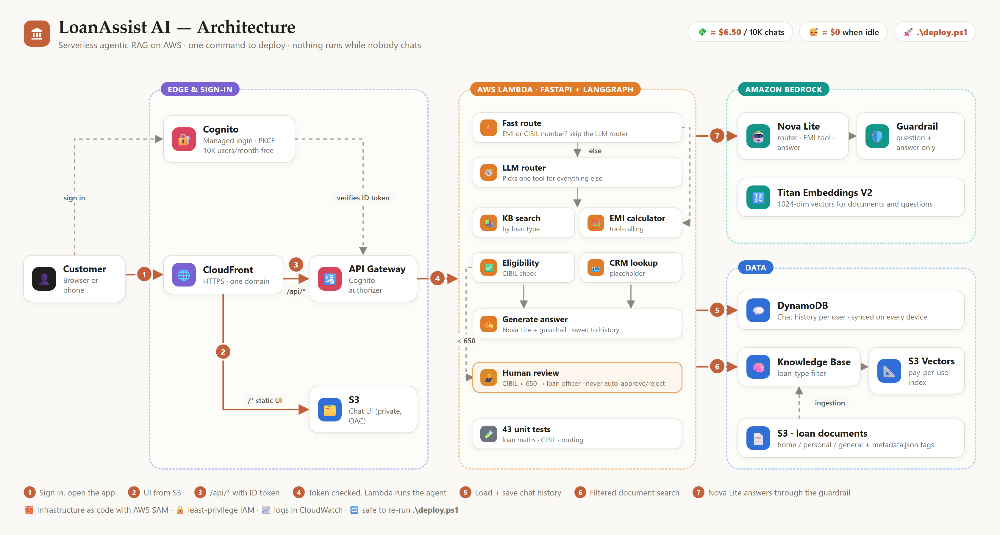
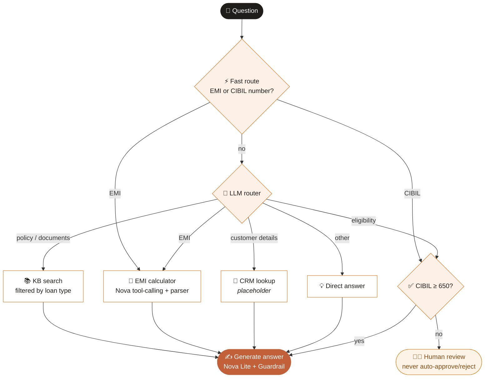
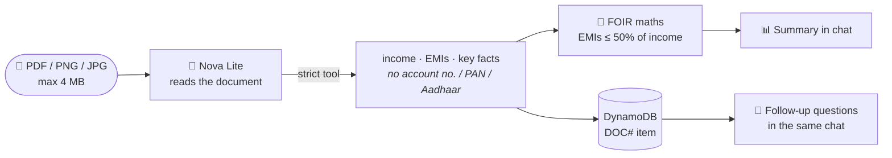

<div align="center">

# 🏦 LoanAssist AI

**A serverless, agentic RAG assistant for loan process and policy questions — deployed to AWS with one command.**


[Screenshots](#-screenshots) · [Features](#-features) · [Architecture](#-architecture) · [Deploy](#-deploy-in-one-command) · [Cost](#-cost-breakdown) · [Evals](#-evaluation--observability) · [API](#-api) · [Run locally](#-run-locally)

<br/>



</div>

> [!IMPORTANT]
> LoanAssist is **informational only**. It never approves or rejects a loan, and it is not legal or financial advice. A CIBIL score below **650** is always handed to a human loan officer.

---

## 📸 Screenshots

<table>
  <tr>
    <td width="50%"><br/><sub><b>Streaming</b> — answers appear word by word</sub></td>
    <td width="50%"><br/><sub><b>Ask about your document</b> — debt-to-income check, time stamps and 👍👎 feedback (dark mode)</sub></td>
  </tr>
  <tr>
    <td width="50%"><br/><sub><b>Sign in</b> — Cognito accounts, history synced across devices</sub></td>
    <td width="50%"><br/><sub><b>Mobile</b> — human-review badge (CIBIL &lt; 650) and slide-out history</sub></td>
  </tr>
</table>

<p><br/><sub><b>Interactive EMI card</b> — sliders, live EMI, year-by-year principal vs interest chart and repayment table</sub></p>

<sub>Screenshots use sample chats; answers are the same ones the deployed app returned for these questions.</sub>

---

## ✨ Features

| | |
|---|---|
| 🤖 **Agentic routing** | A LangGraph router sends each question to the right tool: document search, EMI calculator, eligibility check, customer lookup or a direct answer. |
| 📚 **RAG over your documents** | Drop PDFs/DOCX/MD into `knowledge-base/`; they are embedded with Titan V2, stored in **S3 Vectors** and filtered by loan type. |
| 🧮 **Smart EMI calculator** | Nova tool-calling understands *50 lakh*, *1.2 crore*, *25 saal*, any word order and follow-ups like *"and for 15 years?"*; a rule-based parser backs it up. The EMI text is written by code, so the numbers are always exact. |
| 🎚️ **Interactive EMI card** | Under every EMI answer: sliders for amount, rate and tenure, live EMI and total interest, a year-by-year principal vs interest chart with hover, and a repayment table. |
| 🧑‍⚖️ **Human-in-the-loop** | Low CIBIL scores are flagged for loan-officer review — no automatic decisions. Only numbers written next to "CIBIL"/"credit score" count. |
| 🛡️ **Guardrails** | Bedrock Guardrails filter hate, insults, sexual content, violence, misconduct and prompt attacks on the user's question and on every answer. |
| ⚡ **Fast routing** | Clear EMI and CIBIL questions skip the LLM router entirely. |
| 🔐 **Sign-in** | Email + password accounts with Amazon Cognito managed login. Every API call is checked by a Cognito authorizer. |
| 🗂️ **History on every device** | Chats are saved per user in DynamoDB: open them on your phone or laptop, rename, search and delete. The agent also remembers earlier messages in the same chat. |
| ✨ **Smart chat names** | Chats are named from the first question, e.g. *EMI · ₹50,00,000 at 8.5% for 20 yrs* or *Eligibility · CIBIL 620*. |
| ⚡ **Streaming answers** | Answers appear word by word (Bedrock ConverseStream → API Gateway REST response streaming), with an automatic fallback to the normal endpoint. |
| 📎 **Salary slip / bank statement check** | Upload a PDF or image; Nova Lite reads the income and EMIs, and LoanAssist shows debt-to-income, room for a new EMI and an estimated max loan. Ask follow-up questions about the document in the same chat. |
| 📑 **Real citations** | Answers cite the policy documents inline as [1], [2]; a numbered *Sources* list under the answer shows the document, section and **page number** (for PDFs) and opens the exact passage. Asking *“mention citations”* rebuilds the answer from the documents. |
| 👍 **Answer feedback** | Thumbs up/down plus a written *Give feedback* note on every answer. Saved in DynamoDB; a 👎 or a note emails the team. |
| 🕒 **Timestamps** | Every message shows its time, with *Today / Yesterday* dividers. |
| 💬 **Clean chat UI** | Sidebar history, markdown answers and tables, source chips, tool tags, copy button, suggestion prompts, light/dark toggle, mobile friendly. |
| 🚀 **One-command deploy** | `.\deploy.ps1` creates all infrastructure, syncs documents and uploads the UI. No IDs or URLs to copy by hand. |
| 💸 **Near-zero idle cost** | Fully pay-per-use — nothing runs (or bills) while nobody is chatting. |

---

## 🏗 Architecture



<sub>Diagram source: [`docs/architecture.html`](docs/architecture.html), rendered with headless Chrome.</sub>

### A question's journey

| # | Step | What happens |
|:-:|---|---|
| 1 | 🔐 **Sign in** | The customer signs in on Cognito's hosted page and opens the CloudFront URL. |
| 2 | 🌐 **Load the UI** | CloudFront serves the chat UI from a private S3 bucket. |
| 3 | 📨 **Ask** | The browser calls `/api/v1/chat` on the same domain with its ID token. |
| 4 | 🛂 **Check + run** | API Gateway's Cognito authorizer validates the token; Lambda runs the LangGraph agent. |
| 5 | 💬 **Remember** | The last 6 messages of the chat are loaded from DynamoDB; the new turn is saved after the answer. |
| 6 | 📚 **Look it up** | For policy questions, the Knowledge Base searches S3 Vectors, filtered by loan type. |
| 7 | 🤖 **Answer safely** | Nova Lite writes the answer; the guardrail checks the question and the answer. |

**Why one domain?** CloudFront serves the UI *and* forwards `/api/*` to API Gateway. The browser only ever talks to one origin, so there is **no CORS setup and no API URL to configure**.

**How sign-in works:** the browser signs in on Cognito's hosted page (OAuth code flow with PKCE), receives an ID token, and sends it in the `Authorization` header. API Gateway rejects any request without a valid token, and Lambda reads the user id from the verified claims, so each user only ever sees their own chats.

### Agent workflow



### Tech stack

| Layer | Technology |
|---|---|
| Frontend | HTML, CSS, vanilla JavaScript |
| Backend | Python 3.11, FastAPI on uvicorn via **AWS Lambda Web Adapter** (response streaming), Pydantic Settings |
| AI | LangGraph, Amazon Nova Lite, Titan Text Embeddings V2, Bedrock Guardrails |
| Retrieval | Bedrock Knowledge Base + Amazon S3 Vectors |
| Auth & data | Amazon Cognito (managed login, PKCE), Amazon DynamoDB (on-demand) |
| Infrastructure | AWS SAM, Lambda, API Gateway, S3, CloudFront (OAC), IAM, CloudWatch |

### Chat history data model

One DynamoDB table, partitioned by user:

| `pk` | `sk` | Holds |
|---|---|---|
| `USER#<cognito sub>` | `CHAT#<chatId>` | title, createdAt, updatedAt |
| `USER#<cognito sub>` | `MSG#<chatId>#<epoch ms>#<0\|1>` | role, text, answer metadata (sources, tool, review flag), feedback |
| `USER#<cognito sub>` | `DOC#<chatId>#<epoch ms>` | facts extracted from an uploaded salary slip / bank statement |
| `FEEDBACK` | `<epoch ms>#<messageId>` | team review log: rating, comment, question, answer, user, chat |

Every message is its own item, so long chats never hit DynamoDB's 400 KB item limit, and the agent reads only the last 6 messages for context. A message's id is `<epoch ms>-<0|1>`, which is also its timestamp.

### Citations

- Retrieved chunks are grouped **per document** and numbered `[1]`, `[2]` … in the prompt, in the same order as the `sources` returned to the UI, so an inline `[2]` always points at source 2.
- The prompt forbids invented document names, sections or page numbers. If an answer has no sources (e.g. an EMI calculation), the UI hides any stray `[n]`.
- *“Mention citations / what's the source?”* re-runs the search for the previous question and rewrites the answer from the passages only.

### Feedback: where it goes and who is told

| | |
|---|---|
| **On the answer** | `feedback` (up/down) and `feedbackComment` on the `MSG#…` item, so the user sees it again on any device |
| **Team log** | One `FEEDBACK` partition in the chats table with the rating, comment, question and answer, newest last |
| **Alert** | A 👎 or any written note publishes to the SNS topic `FeedbackAlertsTopic`, which emails `AlertEmail` |

Set or change who gets the email (remembered for later deploys; confirm the AWS subscription email once):

```powershell
.\deploy.ps1 -AlertEmail team@yourbank.com
```

Read the feedback log:

```powershell
aws dynamodb query --table-name <ChatsTable> --key-condition-expression "pk = :p" `
  --expression-attribute-values '{\":p\":{\"S\":\"FEEDBACK\"}}' --no-scan-index-forward --max-items 20
```

### Salary slip / bank statement check



- **The file itself is never stored.** Only the extracted numbers and short key facts are saved with the chat, and they are deleted with it.
- **No double counting:** on a salary slip, loan EMIs are payroll deductions, so they are added back to take-home pay before the debt-to-income check (on a bank statement they are not).
- Policy used (from the knowledge base): total EMIs ≤ 50% of monthly income, minimum income ₹25,000, CIBIL < 650 → loan officer review.
- Try it with [`docs/samples/sample-salary-slip.pdf`](docs/samples/sample-salary-slip.pdf) (fictional data).

---

## 🚀 Deploy in one command

### 1. One-time setup

- Install **Python 3.11**, **AWS CLI** and **AWS SAM CLI**
- Configure credentials: `aws configure`, then confirm with `aws sts get-caller-identity`
- Make sure your account can use **Amazon Nova Lite** and **Titan Text Embeddings V2** in `us-east-1`

### 2. Add your documents

Put loan policy files (PDF, DOCX, MD, TXT…) in [`knowledge-base/`](knowledge-base/). Sample policies are included so the app works on the first deploy.

Tag each file with its loan type in a sidecar `<file>.metadata.json`, so a home-loan question only searches home-loan (and general) documents:

```json
{ "metadataAttributes": { "loan_type": "home" } }
```

Valid types: `home`, `personal`, `car`, `education`, `business`, `gold`, or `general` (applies to every question). Untagged files are still searched when no loan type is mentioned, and if a filtered search finds nothing the app retries without the filter.

### 3. Deploy

```powershell
.\deploy.ps1
```

If PowerShell blocks the script, first run `Set-ExecutionPolicy -Scope Process -ExecutionPolicy Bypass`.

<details>
<summary><b>What the script does</b></summary>

1. `sam build` + `sam deploy` (defaults in `samconfig.toml`, no prompts)
2. Creates or updates every resource in `template.yaml`
3. Uploads `knowledge-base/` and runs a Knowledge Base sync, waiting until it finishes
4. Uploads `frontend/`, writes the Cognito sign-in settings into `js/auth-config.js`, and invalidates the CloudFront cache
5. Prints the app URL

Open the URL, choose **Create an account**, confirm the code sent to your email, and start chatting.

The first deploy takes ~10–15 minutes (mostly CloudFront). Later deploys are faster. The script is safe to re-run.

</details>

<details>
<summary><b>Other stack name or region</b></summary>

```powershell
.\deploy.ps1 -StackName my-loanassist -Region us-west-2
```

</details>

### Updating

| You changed… | Do this |
|---|---|
| Backend code, template or UI | `.\deploy.ps1` |
| Documents in `knowledge-base/` | `.\deploy.ps1` (re-syncs the Knowledge Base) |

### 🧹 Delete everything (stop all charges)

> [!CAUTION]
> **Delete the stack when you are done testing, or AWS keeps billing you.** Most resources are pay-per-use, but stored data (S3, S3 Vectors, DynamoDB, CloudWatch logs) and any traffic still cost money. Deleting the stack removes **all users, chat history, document facts, feedback and the knowledge base** — it cannot be undone.

**Option A — one command** (asks you to type the stack name, deletes, then verifies):

```powershell
.\destroy.ps1
```

**Option B — step by step:**

```powershell
# 1. Note the names (buckets, Lambda) before deleting
aws cloudformation describe-stacks --stack-name loanassist-ai --query "Stacks[0].Outputs" --output table

# 2. Empty the two buckets (CloudFormation can't delete non-empty buckets)
aws s3 rm s3://<FrontendBucket> --recursive
aws s3 rm s3://<DocsBucket> --recursive

# 3. Delete the stack (CloudFront takes ~10–15 minutes)
sam delete --stack-name loanassist-ai --no-prompts

# 4. Delete what CloudFormation doesn't own
aws logs delete-log-group --log-group-name /aws/lambda/<LoanAssistFunction name>
aws ssm delete-parameter --name /loanassist/langsmith-api-key   # only if you set up LangSmith
```

**Verify nothing is left** — every command below should print nothing (the first one should say the stack does not exist):

```powershell
aws cloudformation describe-stacks --stack-name loanassist-ai
aws s3api list-buckets --query "Buckets[?starts_with(Name, 'loanassist-ai-')].Name" --output text
aws bedrock-agent list-knowledge-bases --query "knowledgeBaseSummaries[?name=='loanassist-ai-kb'].knowledgeBaseId" --output text
aws dynamodb list-tables --query "TableNames[?starts_with(@, 'loanassist-ai-')]" --output text
aws cognito-idp list-user-pools --max-results 60 --query "UserPools[?Name=='loanassist-ai-users'].Id" --output text
aws sns list-topics --query "Topics[?contains(TopicArn, ':loanassist-ai-')].TopicArn" --output text
aws logs describe-log-groups --log-group-name-prefix /aws/lambda/loanassist-ai- --query "logGroups[].logGroupName" --output text
```

> [!NOTE]
> `sam deploy` also created a small shared bucket for build artifacts (stack **`aws-sam-cli-managed-default`**). It costs cents and other SAM projects may use it. To remove it too: empty the bucket shown in that stack's outputs, then `aws cloudformation delete-stack --stack-name aws-sam-cli-managed-default`.
>
> Finally, check **AWS Billing → Bills** the next day to confirm no LoanAssist charges remain.

### What gets created

| Resource | Purpose |
|---|---|
| `DocsBucket` | Private S3 bucket holding loan documents |
| `VectorBucket` + `VectorIndex` | S3 Vectors store (1024-dim, cosine) |
| `KnowledgeBase` + `KnowledgeBaseDataSource` | Bedrock KB using Titan V2 embeddings |
| `Guardrail` + `GuardrailVersion` | Content and prompt-attack filters |
| `LoanAssistFunction` + `LoanAssistApi` | Lambda (FastAPI) behind API Gateway |
| `FrontendBucket` + `Distribution` | Private UI bucket served by CloudFront (OAC) |
| `ChatsTable` | DynamoDB on-demand table for per-user chat history |
| `UserPool` + `UserPoolDomain` + `UserPoolClient` + `ManagedLoginBranding` | Cognito accounts and hosted sign-in / sign-up page |
| IAM roles | Least-privilege, scoped to the exact model, KB, Guardrail, table, bucket and index |

---

## 💰 Cost breakdown

All prices are **us-east-1 on-demand**, as published by AWS at the time of writing. Prices change, so confirm with the [AWS Pricing Calculator](https://calculator.aws/) before going to production.

### Unit prices

| Resource | What you pay for | Price |
|---|---|---|
| **Bedrock – Nova Lite** | Input / output tokens (chat, routing, EMI tool, document reading) | $0.00006 / 1K input · $0.00024 / 1K output |
| **Bedrock – Titan Embeddings V2** | Tokens embedded (ingestion + each query) | $0.00002 / 1K tokens |
| **Bedrock – Guardrails** | Text units checked (1 unit = 1,000 characters) | $0.15 / 1K text units (content filters) |
| **Bedrock – Knowledge Base** | No separate charge; you pay for the models and vector store it uses | $0 |
| **S3 Vectors** | Storage · uploads · queries | $0.06 / GB-month · $0.20 / GB uploaded · $2.50 / 1M queries |
| **Lambda** (1 GB memory) | Requests · compute time | $0.20 / 1M requests · $0.0000166667 / GB-second |
| **API Gateway** (REST) | Requests | $3.50 / 1M requests |
| **CloudFront** | Data out · requests | Always-free tier: 1 TB + 10M requests / month |
| **S3** (frontend + docs) | Storage · requests | ~$0.023 / GB-month (a few MB here → cents) |
| **DynamoDB** (on-demand) | Writes · reads · storage | $0.625 / 1M write units · $0.125 / 1M read units · $0.25 / GB-month (first 25 GB free, always) |
| **Cognito** (Essentials) | Monthly active users (MAU) | First 10,000 MAU free every month (does not expire) · then $0.015 / MAU |
| **SNS** (feedback emails) | Email notifications | First 1,000 emails / month free, then $2 per 100,000 |
| **CloudWatch Logs** | Ingestion · storage | $0.50 / GB ingested · free tier 5 GB / month |

### Estimated monthly bill

Assumptions per chat message: Nova Lite ≈ 1,700 input + 320 output tokens (clear EMI/CIBIL questions skip the router call; EMI questions add a small extraction call), ≈ 3 Guardrail text units (only the user's question + the answer are checked), ~3 s of Lambda at 1 GB, a KB search on about half of all messages, and ≈ 5 DynamoDB write units + 2 read units for history. Users stay under Cognito's 10,000 free MAU.

| Resource | 1K chats / mo | 10K chats / mo | 100K chats / mo |
|---|---:|---:|---:|
| Nova Lite | $0.18 | $1.80 | $18.00 |
| Guardrails | $0.45 | $4.50 | $45.00 |
| Titan embeddings (queries) | <$0.01 | <$0.01 | $0.02 |
| S3 Vectors | <$0.01 | $0.02 | $0.13 |
| Lambda | $0 *(free tier)* | $0 *(free tier)* | ~$1.00 |
| API Gateway | <$0.01 | $0.04 | $0.35 |
| CloudFront | $0 *(free tier)* | $0 *(free tier)* | $0 *(free tier)* |
| S3 | <$0.01 | <$0.01 | <$0.01 |
| DynamoDB | <$0.01 | $0.04 | $0.35 |
| Cognito | $0 *(free tier)* | $0 *(free tier)* | $0 *(free tier)* |
| CloudWatch Logs | $0 *(free tier)* | $0 *(free tier)* | ~$1.00 |
| **Total (approx.)** | **≈ $0.70** | **≈ $6.50** | **≈ $66** |

> [!NOTE]
> **Document checks are cheap too:** reading a 1–2 page salary slip with Nova Lite is ≈ 2–4K input tokens, i.e. about **$0.0003 per upload** (≈ $0.30 for 1,000 uploads). Streaming costs the same as a normal answer.

> [!NOTE]
> Chat history adds well under **1%** to the bill: DynamoDB is ~$0.35 even at 100K chats, and its storage stays inside the free 25 GB for a long time (~5 KB per message pair). Cognito is free up to 10,000 monthly active users; above that each extra user costs $0.015 (e.g. 20,000 users ≈ $150/month).

> [!TIP]
> **Idle cost is ≈ $0.** Every resource is pay-per-use. The previous design used OpenSearch Serverless, which bills for capacity units around the clock (≈ $175+/month even with zero traffic). Switching to S3 Vectors removed that fixed cost.

### Where the money goes and how to cut it

- **Guardrails are the largest line (~70%) and already optimised.** Only the user's question is wrapped in `guardContent`; trusted context (KB text, tool output, history) is skipped, while the answer is still fully checked. This cut guardrail cost by ~60% (≈ 8 → 3 text units per message).
- **The router is skipped** for clear EMI / CIBIL questions (rule-based fast path), saving one Nova call and ~1 s each.
- **Nova Lite**: keep history and retrieved chunks short (4 chunks) and cap `maxTokens`.
- Set a **CloudWatch log retention** period (e.g. 14 days) so logs don't pile up.
- Create an **AWS Budget** alert, e.g. at $10/month.

---

## 🧪 Evaluation & observability

| | Where | What you get |
|---|---|---|
| **Golden-set evals** | [`evals/`](evals/) — locally and in **GitHub Actions** on every push/PR | 50 fixed questions (EMI, eligibility, policy, citations, salary slip, safety) with deterministic checks + an LLM judge. Fails the build on a regression. Current: **50/50, grounded 5/5, p50 1.8 s**. |
| **Tracing** | **LangSmith** (optional) | Every request as a trace: LangGraph nodes → `kb_retrieve`, `nova_router`, `nova_answer_stream`… with per-step timings, inputs and outputs. |
| **Experiments** | **LangSmith** (`run_evals.py --langsmith`) | Each eval run as an experiment on the `loanassist-golden-set` dataset, compared side by side. |

**Rule of thumb: gate quality in CI, look at timings and compare experiments in LangSmith.** The first eval run found real bugs (an LLM-typed EMI that didn't match the maths, invented `[n]` citations, mis-routed policy questions); fixing them took the score from 70% to 100%. See **[evals/README.md](evals/README.md)** for how to run it, add LangSmith and switch on the CI evals.

## 🔌 API

On AWS, use the CloudFront URL as the base: `https://<your-domain>.cloudfront.net/api/...`

Every endpoint except `/api/health` needs the Cognito **ID token** in the header:

```http
Authorization: <id_token>
```

| Method | Path | Purpose |
|---|---|---|
| `GET` | `/api/health` | Health check (no sign-in) |
| `POST` | `/api/v1/chat` | Ask a question; saves both messages to the chat |
| `POST` | `/api/v1/chat/stream` | Same, but streams NDJSON events: `meta` → many `delta` → `done` |
| `POST` | `/api/v1/documents` | Upload a salary slip / bank statement (base64, ≤ 4 MB) → income + eligibility summary |
| `PUT` | `/api/v1/chats/{id}/messages/{messageId}/feedback` | `{ "rating": "up" \| "down" \| null, "comment": "optional note" }` |
| `GET` | `/api/v1/chats` | List your chats (id, title, timestamps) |
| `GET` | `/api/v1/chats/{id}` | One chat with all its messages |
| `PATCH` | `/api/v1/chats/{id}` | Rename: `{ "title": "New name" }` |
| `DELETE` | `/api/v1/chats/{id}` | Delete a chat and its messages |

### `POST /api/v1/chat`

`session_id` is the chat id (create a new UUID for a new chat). `title` is only used when the chat is new.

```json
{ "message": "What documents are required for a home loan?", "session_id": "3f9c…", "title": "Home loan documents" }
```

<details>
<summary><b>Example responses</b></summary>

Document question:

```json
{
  "answer": "For a home loan you will need: ...",
  "session_id": "demo-001",
  "sources": [{ "uri": "s3://.../home-loan.md", "excerpt": "..." }],
  "tool_used": "retrieve_loan_documents",
  "requires_human_review": false
}
```

CIBIL below 650:

```json
{
  "answer": "Your CIBIL score needs manual review by a loan officer. No automatic approval or rejection has been made.",
  "session_id": "demo-001",
  "sources": [],
  "tool_used": "check_loan_eligibility",
  "requires_human_review": true
}
```

</details>

### Quick test checklist

| Ask | Expect |
|---|---|
| What documents are required for a home loan? | `retrieve_loan_documents` + source chips |
| Calculate EMI for a 5000000 loan at 8.5% for 20 years | `calculate_emi`, ≈ ₹43,391 / month |
| My CIBIL score is 720. Am I eligible? | `check_loan_eligibility`, no review |
| My CIBIL score is 620. Am I eligible? | `check_loan_eligibility`, **human review** badge |

---

## 💻 Run locally

```powershell
python -m venv venv
venv\Scripts\activate
pip install -r requirements.txt
```

Create `.env` (take the IDs from the deployed stack outputs; leave the guardrail empty to skip it locally):

```env
AWS_REGION=us-east-1
BEDROCK_MODEL_ID=amazon.nova-lite-v1:0
BEDROCK_KNOWLEDGE_BASE_ID=YOUR_KNOWLEDGE_BASE_ID
BEDROCK_GUARDRAIL_ID=
ALLOWED_ORIGINS=http://localhost:5500
```

```powershell
uvicorn src.app.main:app --reload --port 8000
python -m http.server 5500 --directory frontend
```

Open <http://localhost:5500>. On localhost, `frontend/js/config.js` automatically points to `http://localhost:8000`.

Locally there is **no sign-in**: `frontend/js/auth-config.js` is `null`, so the UI keeps history in the browser and the backend keeps it in memory. To use the real DynamoDB table instead, add `CHATS_TABLE=<ChatsTable output>` to `.env`.

---

## 📁 Project structure

```text
loanassist-ai/
├── frontend/              # Chat UI (index.html, css/, js/app.js, js/auth-config.js)
├── knowledge-base/        # Documents + <file>.metadata.json loan-type tags
├── src/
│   └── app/
│       ├── main.py        # FastAPI routes
│       ├── agent.py       # LangGraph state, tools and routing
│       ├── documents.py   # Salary slip / bank statement summary
│       ├── loan_math.py   # EMI parsing/maths, CIBIL + loan-type detection, fast routing
│       ├── observability.py # optional LangSmith tracing
│       ├── config.py      # Environment settings
│       ├── schemas.py     # Request / response models
│       └── services/
│           ├── bedrock.py     # Bedrock Converse + KB Retrieve
│           └── chat_store.py  # Chat history (DynamoDB, or in-memory locally)
├── template.yaml          # All AWS infrastructure (SAM)
├── samconfig.toml         # Deploy defaults (no secrets)
├── deploy.ps1             # One-command deploy
├── destroy.ps1            # Delete everything + verify (stops all charges)
├── evals/                 # 50-case golden set, runner, results (see evals/README.md)
├── .github/workflows/     # CI: tests on every push, evals when AWS access is set up
├── tests/                 # pytest: loan maths, CIBIL, routing, API, streaming, documents
├── run.sh                 # Lambda start-up (uvicorn behind the Lambda Web Adapter)
├── docs/                  # architecture diagram, screenshots, sample salary slip
└── requirements.txt
```

Run the tests:

```powershell
pip install pytest
python -m pytest -q tests
```

---

## 🩺 Troubleshooting

<details>
<summary><b>Deploy fails on a Bedrock or S3 Vectors resource</b></summary>

- Check that Nova Lite and Titan Text Embeddings V2 are available in your region.
- Update the AWS SAM CLI if it doesn't recognise `AWS::S3Vectors::*`.
- CloudFormation → your stack → **Events** shows the exact error.

</details>

<details>
<summary><b>Knowledge Base sync status is FAILED</b></summary>

Bedrock → Knowledge Bases → your KB → Data source → sync history shows the error for each file (e.g. an unsupported file type).

</details>

<details>
<summary><b>Chat returns 502 / "temporarily unavailable"</b></summary>

Stream the Lambda logs:

```powershell
sam logs --stack-name loanassist-ai --tail
```

Typical causes: Bedrock `AccessDenied` (model changed without redeploying), a missing dependency, or a timeout.

</details>

<details>
<summary><b>Sign-in problems</b></summary>

- **"Sign-in expired. Please try again."**: the sign-in was started in another tab or took too long. Click **Sign in** again.
- **No verification email**: Cognito's built-in email sender is limited to about 50 emails per day. For real users, connect Amazon SES to the user pool.
- **Signed out unexpectedly**: the refresh token lasts 30 days, after which you need to sign in again.

</details>

<details>
<summary><b>The site still shows the old UI</b></summary>

Run `.\deploy.ps1` again (it invalidates the cache), then hard-refresh with `Ctrl+F5`. A brand-new distribution can take a few minutes to start serving.

</details>

---

## 🔐 Security

- ✅ Cognito sign-in (PKCE, no client secret in the browser); API Gateway rejects requests without a valid token
- ✅ Per-user data isolation: the user id comes from verified token claims, never from the request body
- ✅ Least-privilege IAM roles scoped to exact ARNs (no wildcards)
- ✅ Private S3 buckets; the UI is readable only through CloudFront OAC
- ✅ HTTPS everywhere via CloudFront
- ✅ Bedrock Guardrails on every generated answer
- ✅ Model output is HTML-escaped before rendering in the UI
- ✅ `.env`, credentials, `venv/` and `.aws-sam/` are git-ignored; `samconfig.toml` holds no secrets

## 🗺 Roadmap

- [x] Cognito sign-in and API authorization
- [x] Persistent chat history on every device (DynamoDB)
- [ ] Amazon SES for sign-up emails (lift Cognito's ~50 emails/day limit)
- [ ] Real CRM / core-banking integration for customer details (no raw PII to the LLM)
- [x] Guardrail on user input only (`guardContent`) to cut cost
- [x] LLM tool-calling for EMI inputs, stricter CIBIL detection, loan-type filter
- [x] Streaming, salary-slip check, feedback + alerts, interactive EMI card
- [x] 50-case eval suite in CI, LangSmith tracing
- [ ] CloudWatch alarms, dashboard and log retention
- [ ] Custom domain (ACM + Route 53) and optional AWS WAF
